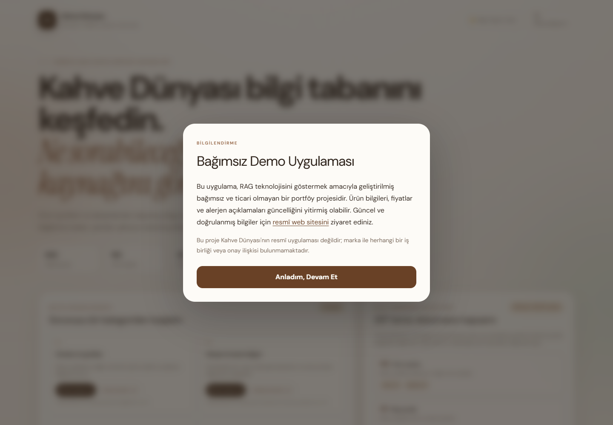
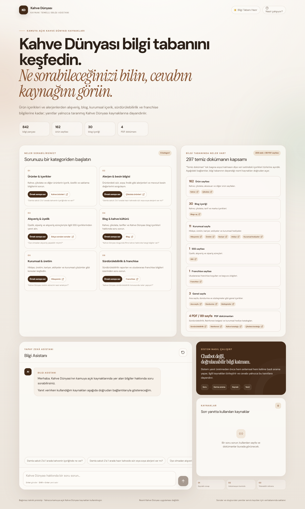
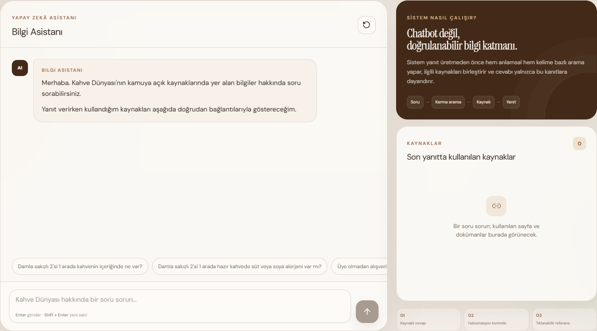

# Bağımsız Kaynaklı Ürün Bilgi Asistanı

Kaynak bağlantılarıyla cevap veren, TypeScript tabanlı bağımsız bir RAG (retrieval-augmented generation) teknik demosudur. Proje herhangi bir marka tarafından hazırlanmış, desteklenmiş veya onaylanmış değildir.

Kodun bileşenlerini ve bir sorunun sistemde nasıl işlendiğini adım adım görmek için [Türkçe mimari açıklamasını](docs/ARCHITECTURE_TR.md) okuyun.

## Canlı demo

[Canlı uygulamayı açın](https://kahve-dunyasi-bilgi-asistani.replit.app/)

Canlı dağıtım bağımsız ve resmî olmayan bir teknik demodur. Dağıtım ortamına ayrıca yüklenen bilgi tabanı bu deponun veya MIT Lisansı'nın parçası değildir.

## Ekran görüntüleri

### Bağımsızlık ve güncellik uyarısı



### Ana sayfa ve bilgi tabanı kapsamı



### Kaynak temelli asistan çalışma alanı



[Mobil tam sayfa görünümünü açın](docs/images/04-mobil-gorunum.png)

## Önemli veri ve marka notu

Bu depo yalnızca uygulama kodunu ve sentetik örnek veri şemasını lisanslar. Üçüncü taraf sitelerden elde edilen ürün metinleri, fiyatlar, görseller, logolar ve marka unsurları depoya dahil edilmez ve MIT Lisansı kapsamında değildir. Ayrıntılar için [DATA_NOTICE.md](DATA_NOTICE.md) dosyasını okuyun.

Gerçek veri dosyaları bilerek `.gitignore` kapsamındadır. Uygulamayı kullanacak kişi, yüklediği veriyi toplama, işleme ve yayımlama hakkına sahip olduğunu kendisi doğrulamalıdır.

## Gereksinimler

- Node.js 24
- pnpm
- İsteğe bağlı: PostgreSQL (`DATABASE_URL` tanımlanmazsa konuşmalar kaydedilmez)
- İsteğe bağlı: Gemini API anahtarı (`GEMINI_API_KEY` tanımlanmazsa kaynak metninden çıkarımsal cevap kullanılır)

## Kurulum

```bash
pnpm install
cp .env.example .env
```

Yetkili olduğunuz bilgi tabanı dosyalarını şu adlarla yerleştirin:

```text
artifacts/api-server/data/kahve-dunyasi/clean_documents.jsonl
artifacts/api-server/data/kahve-dunyasi/clean_chunks.jsonl
```

Şema için `examples/knowledge-base/` altındaki sentetik örneklere bakın. Örnekleri denemek için `.example` uzantısını kaldırarak yukarıdaki aktif veri klasörüne kopyalayabilirsiniz.

## Çalıştırma

Replit'te **Run** düğmesini kullanabilirsiniz. Komut satırında:

```bash
pnpm run build
pnpm --filter @workspace/api-server run start
```

Bilgi tabanı sunucu başlarken belleğe alınır; veri dosyaları değiştiğinde sunucuyu yeniden başlatın.

## Gizlilik

Konuşma kaydı varsayılan olarak kapalıdır. Yalnızca `PERSIST_INTERACTIONS=true` ve `DATABASE_URL` birlikte tanımlanırsa kullanıcı soruları ile cevaplar kaydedilir. Kamuya açık bir kurulumda kullanıcıya uygun bir aydınlatma metni sunun, gereksiz kişisel veri toplamaktan kaçının ve saklama/silme politikasını belirleyin. API anahtarlarını yalnızca Replit Secrets veya ortam değişkenlerinde saklayın; Git'e eklemeyin.

Başka bir alan adındaki frontend'in API'ye erişmesi gerekiyorsa `CORS_ORIGIN` değerine izin verilen tam adresleri virgülle ayırarak yazın. Değişken boşken çapraz alan erişimi açılmaz.

## Lisans

Projeye özgü kaynak kodu [MIT Lisansı](LICENSE) ile sunulur. Bağımlılıklar ve üçüncü taraf bileşenler kendi lisanslarına tabidir. Veri, marka ve üçüncü taraf içerikleri bu lisansın dışındadır.
